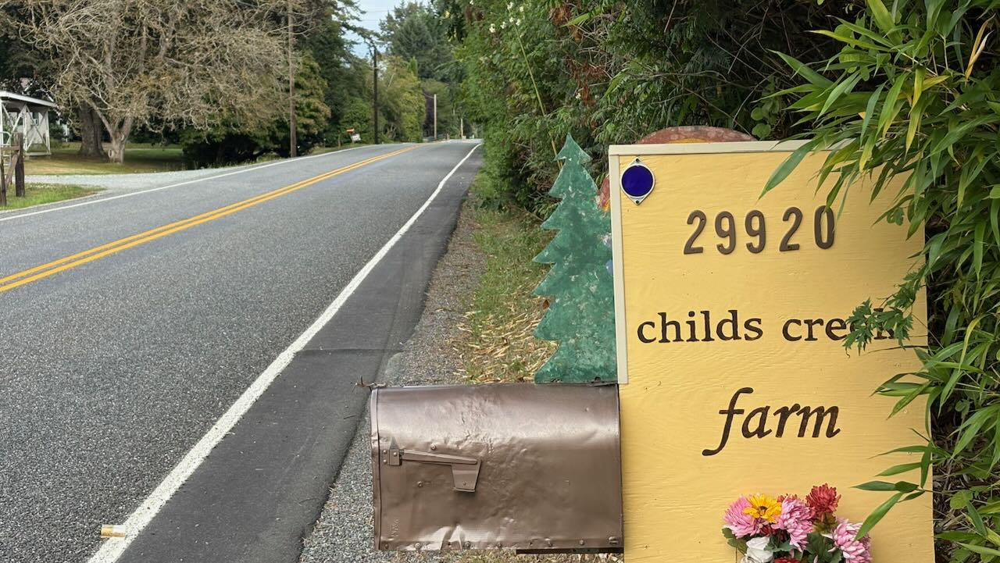
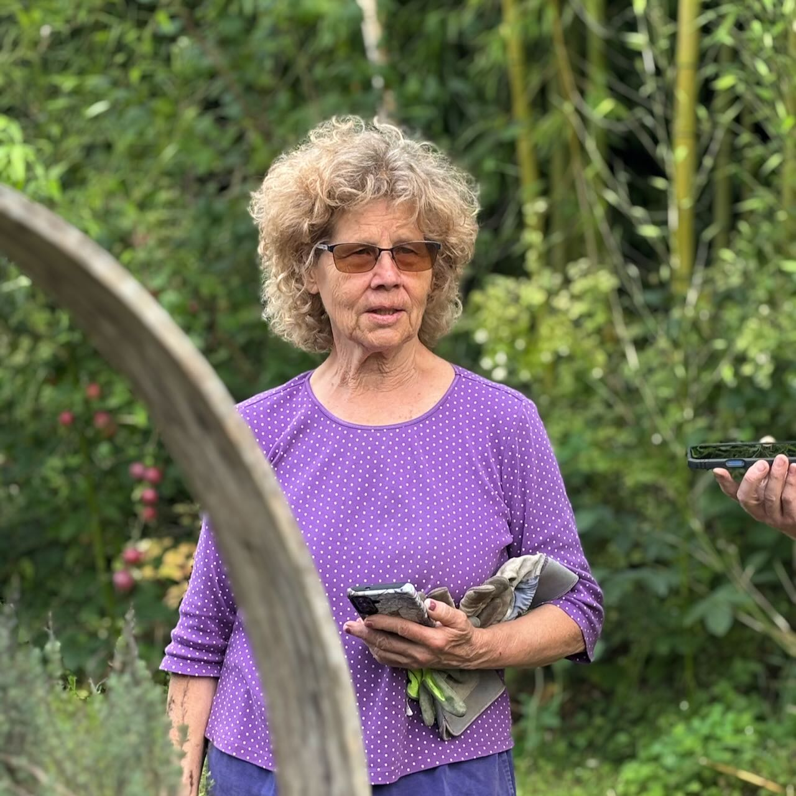
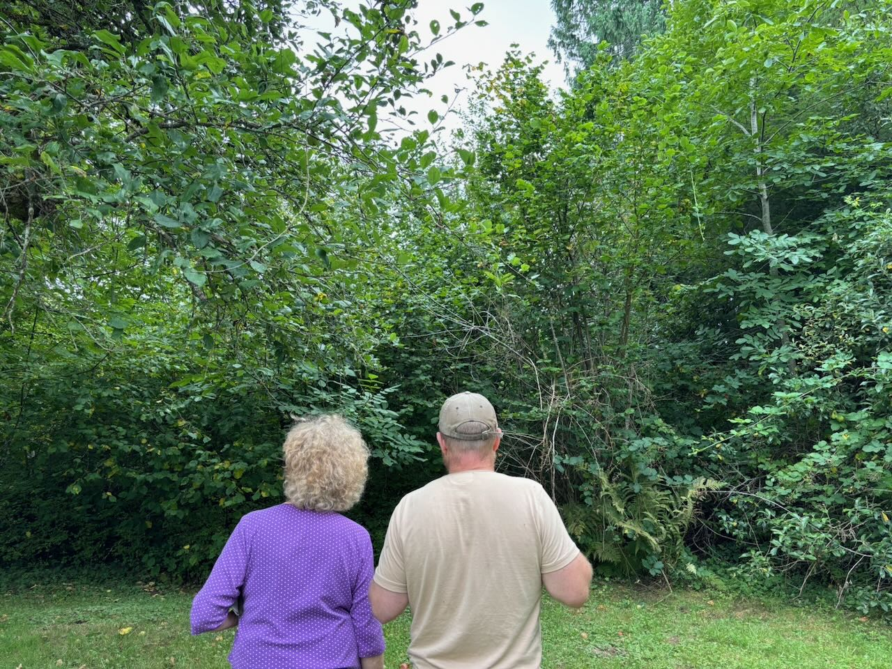
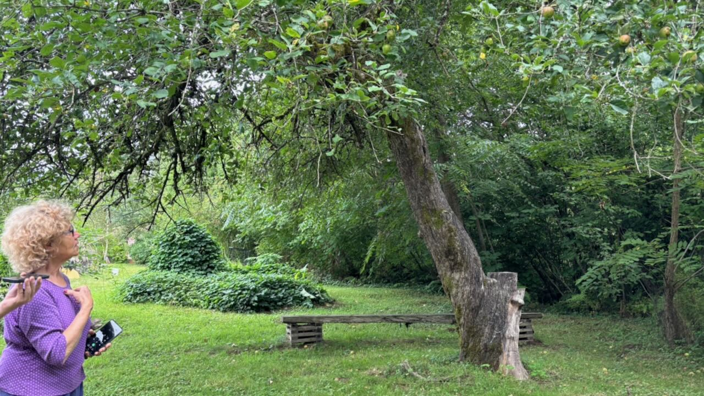
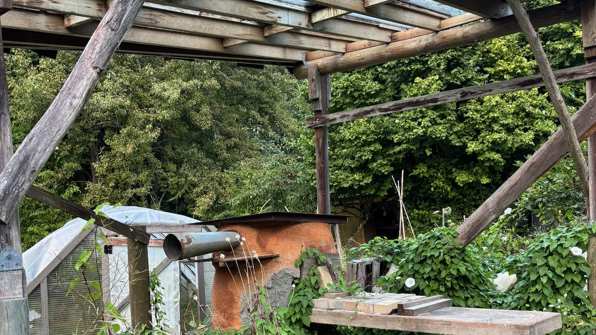
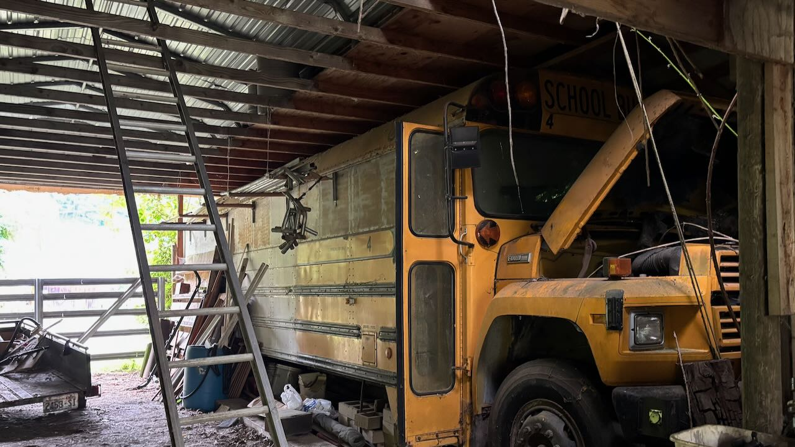
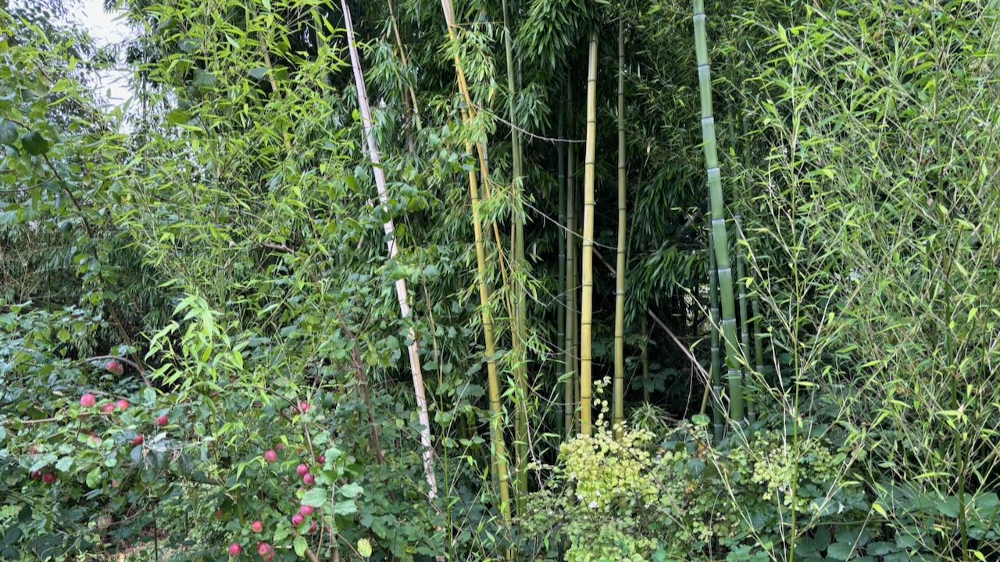
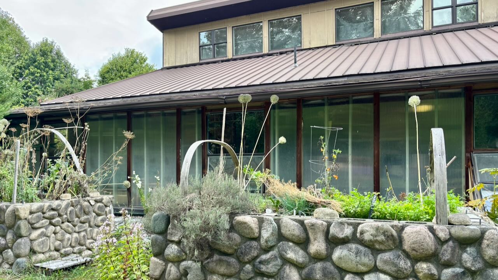
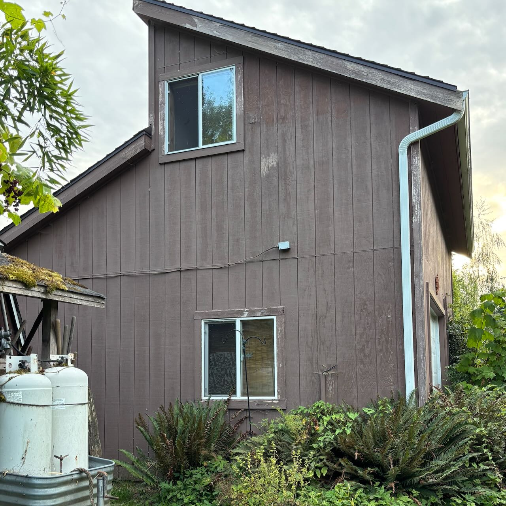
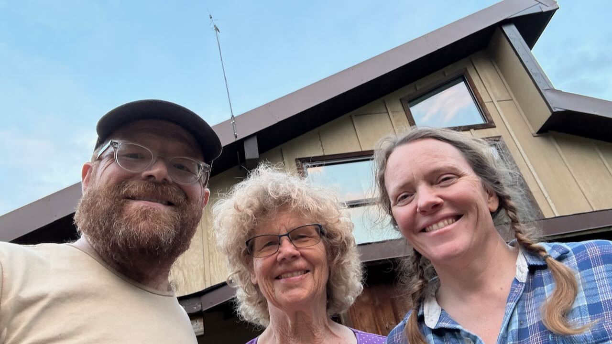

# Saying Goodbye to Childs Creek Farm

They become the shape of your days, the trees you know by name, the paths your feet have learned, the particular light at the end of the afternoon. They become places where children grow up, where gardens are planted and replanted, where buildings are rescued and remade, where people gather, and where the land itself changes over the years.

Childs Creek Farm is one of those places.

This week, Cindy is saying goodbye.

After forty years on the farm, she is selling the property and moving on. Before she left, Geneviève and I walked the farm with her, recording a conversation as she said goodbye to the place she has spent so much of her life tending.

It was less a tour than a walk through memory.

And everywhere we walked, there was evidence of what forty years of attention can do.

## A forest grown from a boundary

We started in the old orchard, near the western edge of the property.

Cindy pointed out the hedgerow: blackberries mixed with Oregon grape and red-flowering currant, with strawberry trees growing along the top of a berm. Beyond them were deciduous trees and tall Douglas fir and western red cedar along the property boundary.

The berm hadn't always been there. When Cindy and her family built the house, there was extra dirt, so they shaped it into a berm along the boundary and planted native trees and plants.

Now it is a mature landscape.

“Look how high it became,” she said.

It is an easy thing to miss when we think about regeneration: **trees don't ask permission to become forests.** Given the opportunity, volunteer trees grow. Hedgerows thicken. Native plants move into the understory. A place that begins as a line of dirt can become habitat.

Cindy laughed about the hazelnuts and walnuts that had arrived on their own. Nearby stood one of the ancient apple trees from the original orchard—old-style Gravenstein apples that were still surviving.

For years, bears had come to those trees.

They would climb the branches, scrape at the trunks, and shake the apples down. Elk came through too. Horses and other animals got their share.

The orchard was never simply a food-production system.

It was part of a larger web.

## From swamp to forest

Looking down from the upper part of the property, Cindy described how different the land had been when she first arrived.

The lower ground flooded every year. Skunk cabbage grew in the wetland. Blackberries had begun to overwhelm the area.

But instead of seeing the wetland as wasted space, Cindy and others began restoring it.

Childs Creek Farm became the site of Skagit County's first Riverways Conservation Reserve Enhancement Project. More than 800 trees and shrubs representing 22 species were planted.

Twenty-five years later, Cindy estimates that those plantings have become something closer to 8,000 plants—a new forest growing where the blackberry thicket once dominated.

That transformation is one of the things that stays with me from the walk.

Regeneration is often difficult to see while it is happening.

A seedling looks small. A berm looks like a pile of dirt. A wetland restoration can look like a muddy patch of ground.

Then one day you look up and realize you've been standing inside a forest you helped begin.

## Diversity instead of rows

As we walked through the gardens, Cindy kept returning to one idea:

**diversity.**

There were herbs and flowers, fruit trees and vines, perennial vegetables, pollinator plants, native species and introduced plants growing together.

She described trying to put more perennial plantings throughout the garden because they require less ongoing energy and provide habitat for pollinators and other species.

I told her I'd been thinking about my own gardening as an “anti-row” garden.

“Polyculture and no rows,” she said.

That phrase felt like a fitting description of much of Childs Creek Farm.

The garden wasn't trying to impose a single pattern everywhere. It was an accumulation of relationships.

Asparagus planted from seed five years ago was coming back year after year. Rhubarb grew beside the hoop house. Jerusalem artichokes, borage, herbs, kale, Swiss chard, beets, grapes, peas and beans occupied different parts of the garden.

There were fruit trees competing with bamboo, bamboo competing with blackberries, and native plants finding their way among everything else.

It wasn't tidy in the conventional sense.

It was alive.

## A farm with dessert along the path

The tour was also, quite literally, a tour with snacks.

We ate plums directly from the trees. We tasted apples. We stopped for grapes.

Cindy showed us her favorite apples—the early Sweet Williams and Williams Pride—and told us about the yellow Green Gage plums she especially loved eating when they were very ripe.

Then there were the hardy kiwis.

They grew over a structure near the farm's shipping and receiving area, which was partly supported by an old school bus. Cindy had harvested them with us the year before.

They were enormous.

One more month, she figured, and they'd be ready.

These moments were small, but they captured something important about the farm. Food wasn't confined to a designated production zone. It was woven through the landscape.

You could walk from one part of the property to another and find something to eat.

## Lemon balm and the gift of a recipe

At one point, we stopped beside an herb garden and Cindy shared the recipe for her restorative tea.

It is simple:

- **½ lemon balm**
- **¼ mint**, any kind
- **Spring nettles**, if you want to add them

She makes it primarily with lemon balm, mixed with mint and sometimes nettles.

As she put it, there was no reason to trademark it now.

She wanted to get the recipe out to everyone.

That struck me as another kind of regeneration: **a gift that becomes more valuable when it is shared.**

A plant spreads. A recipe spreads. A practice spreads. Someone learns something from you and carries it somewhere else.

## Solar, biodiesel, bamboo, and experiments

Childs Creek Farm is also full of experiments.

The Sun Star House, as Cindy calls it, was a cedar home rescued from elsewhere in the valley and reconstructed as a sustainable, south-facing passive-solar home. She has lived there since 2007.

There was a grid-connected solar installation that Cindy believes was the first of its kind in Skagit County. After roughly twenty years, it needs some attention, but much of the system remains.

There were earlier experiments with biodiesel, using waste grease collected from restaurants and other sources.

There was timber bamboo—the kind used around the world for building—that had grown enormous enough to provide bamboo for an arch at our own wedding.

There were hugelkultur beds, hoop houses, community gardens, perennial plantings and rescued buildings.

None of these things were presented as a perfect system.

They were experiments.

Some worked better than others. Some needed maintenance. Some lasted decades. Some changed into something nobody originally anticipated.

That, too, feels important.

Regeneration isn't perfection.

It is participation.

## The community building

One of my favorite parts of the farm was the community building.

It began as a practical project. Cindy's daughters were teenagers and sharing a small bedroom, so a garage/shop was constructed with an upstairs room. Over the years, the building became a place for the girls to get away, and eventually a gathering and crafting space.

From its deck, Cindy described the movement of neotropical migrant birds through this part of the valley.

She calls this area the “rainbow zone”—a middle ground between the cooler, foggier areas toward the Sound and the colder, windier country farther into the mountains.

It is also the middle ground that Cindy herself loves.

One foot toward the Sound.

One foot toward the upper Skagit and the Cascades.

And Childs Creek Farm in between.

## The gift of the Woofers

During the COVID years, Childs Creek Farm became home to a succession of young people who came to work and learn on the farm.

About a dozen people stayed, ranging from two weeks to two months.

Together they worked on the food forest, removed blackberries, and dug out enormous blackberry roots. Cindy remembers them burning the roots and making twisted sculptures from them.

She calls having those young people there one of the silver linings of that difficult period.

I asked her whether hosting them had been worthwhile.

“Absolutely.”

She described it as one of the most wonderful things you can do if you have the space.

People bring energy. They bring labor. They bring ideas. And they learn.

A farm can become not just a place where food is grown, but a place where **people grow**.

## What are we actually passing on?

As we walked toward the eastern part of the property, Cindy showed us the food forest and the old barn.

She pointed out a huge bigleaf maple, perhaps one of the largest in Western Washington, and told us about another favorite place farther down the hill: an enormous cedar stump, more than fifteen feet across, from which five new cedars have grown.

Trees growing out of the heart of an old tree.

A cedar cathedral.

It was impossible not to think about time.

Cindy has reached her seventies. She is letting go of the property after forty years.

But she isn't simply leaving behind a house, an orchard, a garden and a forest.

She is leaving behind **time made visible**.

And that raises a question at the heart of what we're exploring through Regenerate Skagit:

### What are we building for the people who come after us?

When we first began talking about Regenerate Cascadia, one of the questions we kept returning to was:

**What would this place look like in 150 years?**

I asked Cindy what she hoped Childs Creek Farm would look like then.

Her answer was not complicated.

She hoped the large trees would still be there.

She hoped the diversity of plants and animals would continue.

She hoped there would still be places where people could gather, create, make art, dream and enjoy the land.

And maybe, if she was lucky, that legacy would continue for four generations.

## Passing it forward

As we stood outside her home for the last time, I asked Cindy what feeling was closest to her heart.

She talked about the house as a safe haven—a cedar home rescued from waste and rebuilt with care. She talked about its connection to the sun, the land and the spirit of the place.

And she talked again about the Middle Skagit.

There was peace in being rooted here, between the Sound and the mountains.

Then I asked her if she could give the next owners a blessing for the place.

She said:

> “To love the place, enjoy the sun, and the wind, and the many birds, and animals, as well as all the plant diversity that is here, and may their love as a family grow in order to connect with the land and the place.”

That feels like a good blessing not only for Childs Creek Farm, but for all of us.

Because regeneration isn't ultimately about preserving one particular garden, farm, building, or landscape exactly as we found it.

It is about relationship.

It is about learning to love a place deeply enough that we become responsible to its future.

It is about planting trees whose shade we may never sit beneath.

It is about sharing the recipe instead of trademarking it.

It is about making room for young people to learn.

It is about restoring wetlands and watching forests return.

It is about building places where people can gather.

And it is about knowing when it is time to let go.

Cindy is saying goodbye to Childs Creek Farm this week.

But the goodbye isn't really an ending.

The trees are still growing.

The apples are still ripening.

The kiwis are almost ready.

The wetland is becoming a forest.

The frogs are still calling from the pond.

And somewhere beneath all of it is the accumulated work of forty years—a living legacy that is now being handed to another generation.

**May they love the place.**

**May they enjoy the sun and the wind, the birds and animals, and all the diversity that lives here.**

**And may their love for one another grow alongside their connection to the land.**

